# Explaining `01-exploration.ipynb`

## Purpose of the notebook

This notebook performs **exploratory data analysis (EDA)** for a binary network-intrusion problem. The goal is to understand the differences between:

- **Normal traffic**: flows with label `is_anomaly = 0`
- **Denial-of-Service traffic**: flows with label `is_anomaly = 1`

The notebook does **not** train an intrusion-detection model and does not split the data into training and test sets. The purpose of this stage is to understand the data, identify useful measurements, check assumptions, and formulate the anomaly-detection task.

A good one-sentence summary for a professor is:

> “This notebook explores whether categorical and numerical characteristics of network flows can distinguish Normal traffic from DoS traffic, while checking class balance, duplicated measurements, unusual values, and relationships between features.”

## 1. Dataset and variables

The notebook reads the combined dataset from `content/normal_dos.csv` using pandas.

```python
data = pd.read_csv("content/normal_dos.csv", keep_default_na=False)
```

`keep_default_na=False` tells pandas to keep empty categorical strings as empty strings instead of automatically converting them to missing values. This is useful because some entries may use `-` or an empty string to represent an unknown category.

### Understanding one row

Each row represents one **network flow**. A flow is a summary of packets exchanged in a connection or communication between two endpoints.

Some possible meanings in this dataset are:

- A web browser establishes a connection and downloads a page.
- A DNS client asks a server to resolve a domain name.
- A service sends packets that do not receive a recorded response.
- A large group of packets could be recorded as a DoS attempt.

It is important to distinguish packets from flows:

- A **packet** is one unit transmitted through a network.
- A **flow** is a group or summary of packets that belongs to an exchange.

### Selected features

The categorical features are:

- `proto`: network protocol, such as TCP, UDP, ARP or ICMP
- `service`: application service, such as HTTP, DNS or SMTP
- `state`: recorded state of the exchange, such as FIN or INT

The numerical features are:

| Variable | Meaning | Unit used by the notebook |
|---|---|---|
| `dur` | Flow duration | Seconds in the dataset; scaled plots show milliseconds or microseconds |
| `spkts` | Packets sent in the source/forward direction | Packets |
| `dpkts` | Packets returned in the destination/return direction | Packets |
| `sbytes` | Bytes sent forward | Bytes; plots show kB |
| `dbytes` | Bytes returned | Bytes; plots show kB |
| `rate` | Packet rate | Packets/second |
| `sload`, `dload` | Forward and return data loads | Bits/second; plots show Mbit/s |
| `sinpkt`, `dinpkt` | Mean gap between packets forward and back | Milliseconds |

`X` contains the 13 selected features. `y` is the class label:

```python
y = data["is_anomaly"]
```

The label is not used as an input feature. However, it is used to compare groups and determine whether patterns differ by class.

## 2. Data-quality checks

The first checks verify the basic structure of the data:

- Column types
- Missing values
- Negative numerical values
- Infinite numerical values
- Empty category names
- Number of unique values

Negative and infinite values are especially important because several calculations and plots would behave incorrectly if such values existed. Empty categories are checked separately because pandas does not necessarily interpret them as missing values.

### Class balance

```python
counts = pd.Series({"Normal": len(normal), "DoS": len(dos)})
```

The notebook reports approximately **93,000 Normal flows and 16,353 DoS flows**, so about **15%** of the observations are DoS. This is a class-imbalance problem.

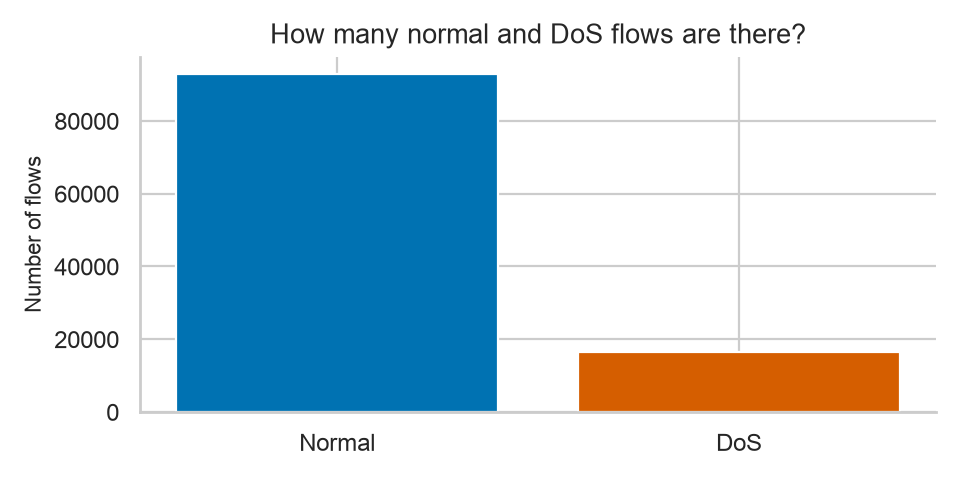

The code creates a bar chart whose height is the number of flows in each class. A bar chart is appropriate because the labels are categorical classes.

**Why this matters:** accuracy alone is not a reliable evaluation metric when one class is much more common than the other. If, for example, a classifier always predicts Normal, it could still look accurate on this dataset. A later model should also use metrics such as precision, recall, false-positive rate, and class-specific F1-score.

### Duplicate feature vectors

The notebook counts rows that have identical values in the 13 selected features:

```python
data.duplicated(subset=features)
```

Repeated measurements are not automatically errors. They can result from repeated traffic, rounded measurements, or flows summarized in the same way. However, duplicated observations affect frequency-based plots and can make rare-looking patterns occur more often than they otherwise would.

The notebook also checks whether a feature pattern occurs with both labels:

```python
label_counts = data.groupby(features)["is_anomaly"].nunique()
```

There are **24 feature patterns that occur with both labels**. This means these selected measurements alone are not sufficient to distinguish every flow perfectly. If an identical feature vector has both labels, a deterministic classifier based only on those features cannot assign the correct label in every case.

## 3. Categorical variables

The categorical columns are compared with normalized class percentages rather than raw counts:

```python
percentages = 100 * counts / [len(normal), len(dos)]
```

This divides each category count by the size of its class. Therefore, for example, a bar of 50% means 50% of that class contains the category. Raw counts would be misleading because there are more Normal flows in total.

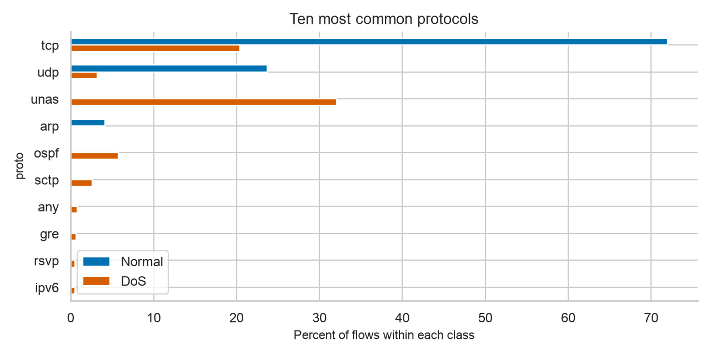

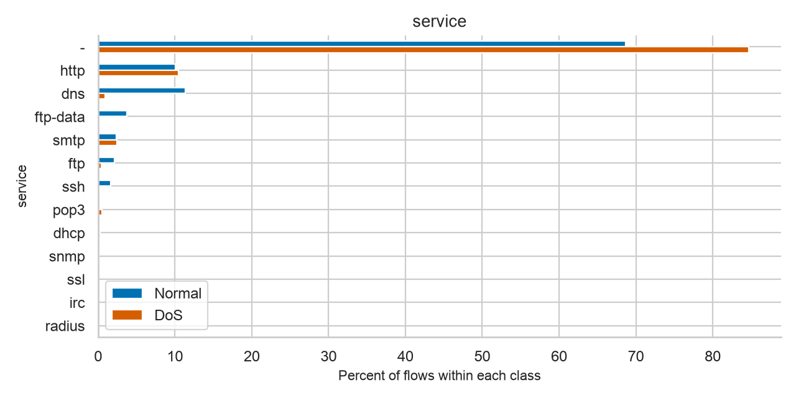

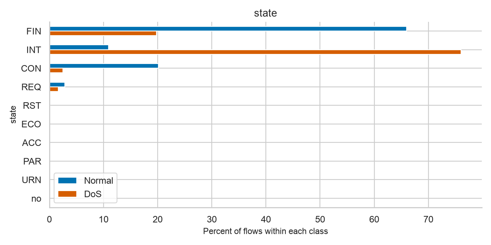

### How to read these diagrams

- The horizontal axis is the percentage within Normal or DoS traffic.
- The blue bars represent Normal flows.
- The orange bars represent DoS flows.
- Each pair compares the same category across classes.

TCP and UDP occur in both classes, and states such as `FIN` and `INT` occur in both classes. Consequently, a category value by itself is not enough to prove that a flow is an attack.

A protocol can also be informative because it is associated with behavior patterns. A protocol absent from Normal traffic in the dataset may be highly associated with DoS here, but that association does not mean the protocol is inherently malicious. It may simply reflect dataset composition or an unusual recording environment.

## 4. Numerical variables

The notebook uses both `describe()` and class-specific statistics:

- Mean: average value; sensitive to extreme observations
- Standard deviation: typical spread around the mean
- Median: middle value; robust to extreme observations
- Quartiles: divide sorted data into four parts

### Full-range histograms

A histogram groups values into intervals called **bins** and counts observations in each bin.

```python
ax.hist(values_normal, bins=bins)
```

The notebook uses logarithmic bins because some measurements contain both small and extremely large values. On a linear scale, equal-width bars could compress almost all observations into the leftmost bars.

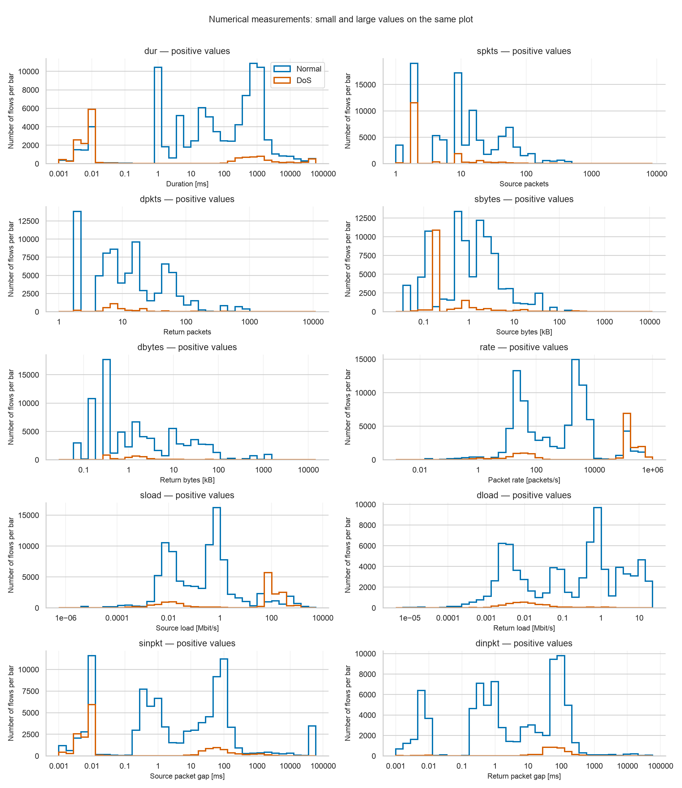

A logarithmic horizontal axis means equal visual distances represent equal multiplicative changes. For example, the distance from 1 to 10 is comparable to the distance from 10 to 100. This makes it possible to inspect skewed distributions without removing extreme values.

**How to interpret the histogram:**

- Peaks show common ranges.
- A distribution shifted to the right has generally larger values.
- Overlapping distributions may still contain useful separation, but no one threshold necessarily gives perfect classification.

### Zoomed histograms

The full-range plot still obscures many common small values. The notebook therefore uses ordinary linear axes to inspect:

- Duration from 0 to 100 microseconds
- Source packet counts
- Packet rate from 0 to 20,000 packets/second

The source packet histogram uses one bar per packet count.

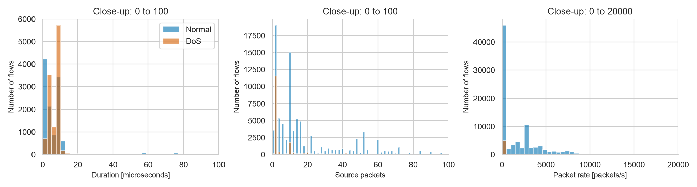

Many DoS flows have few source packets and very short durations. Packet rate can nevertheless be high because rate is calculated as packets divided by flow duration. Two packets in a very short interval can represent a high rate.

### Zero return traffic

```python
data[feature].eq(0).mean()
```

This calculates the fraction of flows with a zero value for each measurement.

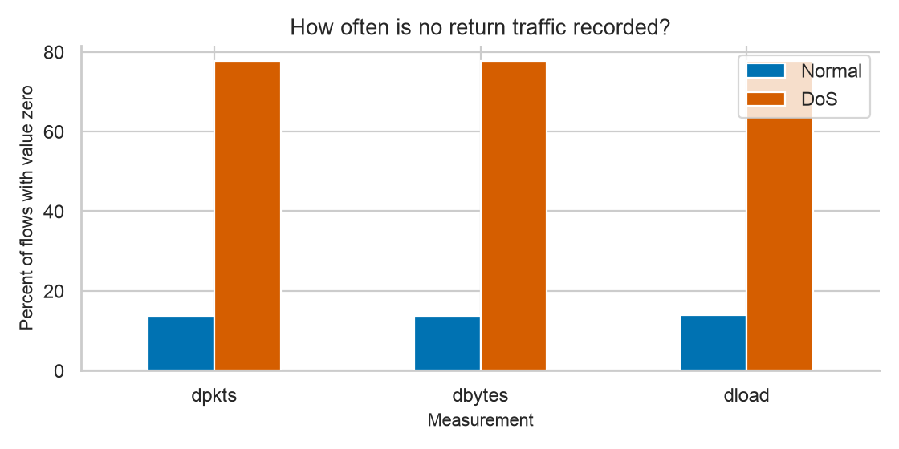

The diagram compares zeros in:

- `dpkts`: number of returned packets
- `dbytes`: number of returned bytes
- `dload`: returned data load

The notebook reports that about **77.7% of DoS flows and 13.8% of Normal flows have no return packets**. This is useful evidence, but it is not a universal rule. One-way traffic can be legitimate, and some DoS traffic may receive responses.

A professor-level explanation should distinguish an observation from a causal claim:

> “The class distributions differ, but the absence of return packets is a feature associated with the observed attacks; it does not establish that all one-way traffic is malicious.”

## 5. Scatterplots and pairplots

A scatterplot places each flow at coordinates `(x, y)`. Each point therefore represents one flow with two measurements.

The notebook uses a reproducible sample of 2,000 flows:

```python
sample = data.sample(n=2000, random_state=42)
```

The random seed makes the selected sample reproducible. Tables and histograms use all rows; only these graphical samples are reduced in size to limit overlap.

### Sent versus received traffic

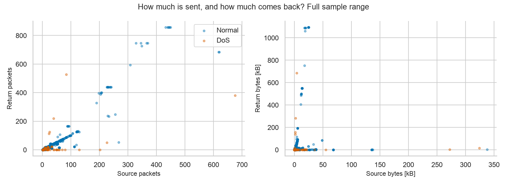

The two plots show:

- Source packets versus return packets
- Source bytes versus return bytes

An upward relationship means that flows with larger source values tend to have larger return values as well. Points near the horizontal axis represent flows with little or no measured return traffic. Because the colors overlap, the two classes cannot be separated by this pair of measurements alone.

### Packet-count pairplot

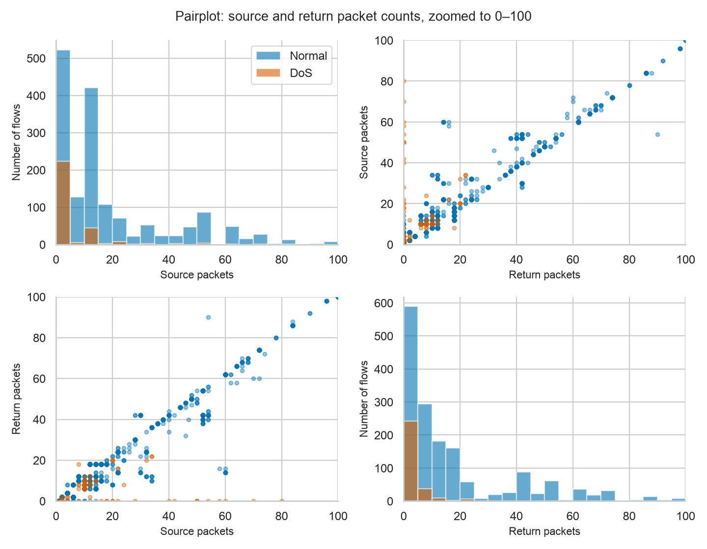

In the pairplot:

- The diagonal panels are histograms of source and return packet counts.
- The off-diagonal panels are scatterplots between those variables.
- Limits of 0–100 reduce the influence of very large values in the display.

The central idea is that a feature can look weak in a one-dimensional histogram but become more useful together with another feature. In this notebook, however, the classes still overlap substantially.

### Relationships between several measurements

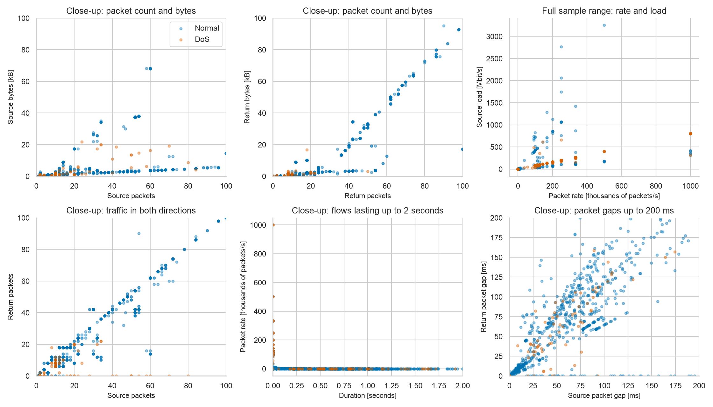

This grid compares relationships such as:

- Packet count and byte count
- Packet rate and load
- Source packets and return packets
- Duration and packet rate
- Packet gaps in both directions

The close-up plots intentionally exclude some very large observations so that common values are visible. The notebook prints the percentage of Normal and DoS flows represented by each close-up, preventing readers from forgetting that the plot is cropped.

### Important graphical distinction

A visible correlation does not prove causation. For example, more packets and more bytes naturally tend to increase together because bytes are built from packet contents and headers. Also, correlation between two features does not by itself prove separation between Normal and DoS traffic.

## 6. Simpson-style protocol context

Overall and protocol-specific results can differ. The notebook demonstrates this with packet rate:

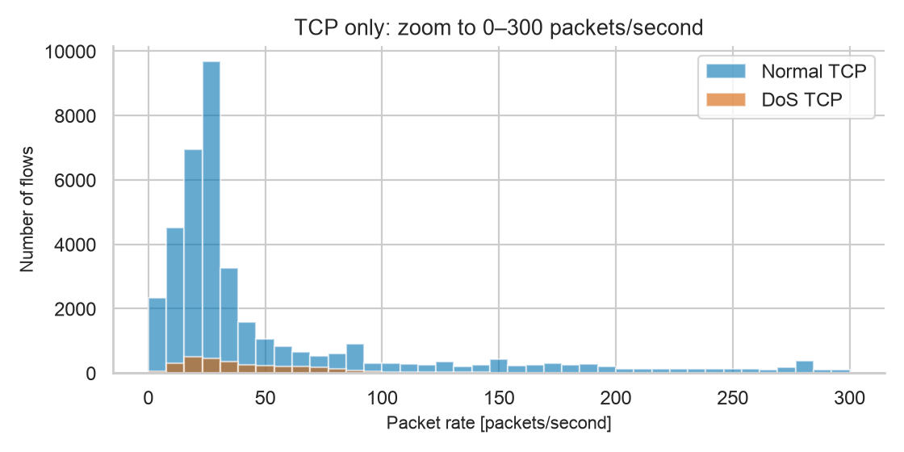

Overall, DoS has a higher median packet rate. Inside the TCP subset, however, DoS has a lower median rate than Normal traffic in the notebook (approximately 38 versus 105 packets/second).

This is why the notebook should not stop at “DoS has a higher rate.” The overall statistic mixes protocols, while TCP-specific behavior reveals a different pattern. Similar context checks should also be performed after grouping by protocol, service, and state.

A useful explanation is:

> “Aggregation can hide subgroup patterns. Therefore, we compare the full dataset and relevant protocol subsets before concluding that a variable is discriminative.”

## 7. Derived features

Two new features are calculated to express network behavior more directly.

### Return packet share

$$
\text{Return packet share} = \frac{dpkts}{spkts + dpkts}
$$

- A value close to 0 means almost no returned packets.
- A value around 0.5 means similar packet counts in both directions.
- If both counts are zero, the result is undefined (`NaN`) rather than assumed to be 0.

### Source bytes per packet

$$
\text{Source bytes per packet} = \frac{sbytes}{spkts}
$$

This estimates the average amount of source bytes associated with each source packet. The calculation is undefined if `spkts = 0`, because division by zero is not meaningful.

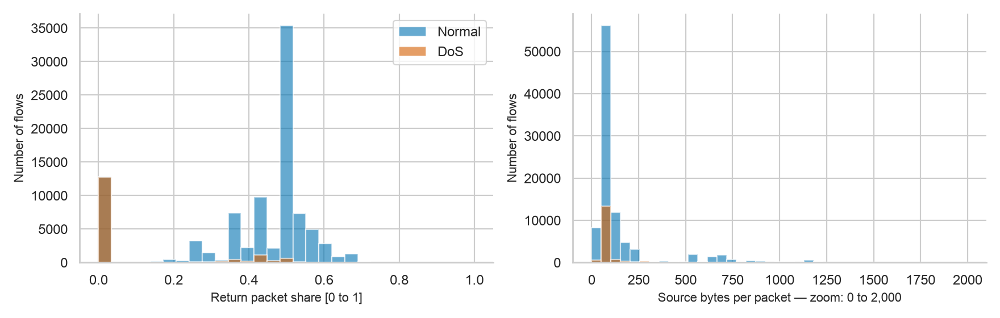

These derived features are ratios rather than completely independent measurements. They are transformations of existing columns. They help interpretation, but do not add new information that is mathematically independent of the source measurements.

## 8. Example rows and hypothesis formation

The final displayed flows connect the statistics and plots back to concrete records. The notebook compares Normal and DoS rows where the protocol is TCP, the service is HTTP, and the state is FIN. It also displays the Normal flow with the most returned bytes.

This step is important because aggregate results can hide unusual exceptions. It asks:

- Do the class-typical patterns also appear in individual records?
- Is a large flow a valid Normal example rather than simply an invalid measurement?
- Do Normal and DoS flows overlap even under the same protocol/service/state context?

The answer is that many representative patterns overlap, so individual measurements are rarely sufficient to guarantee a correct decision.

## 9. Final anomaly-detection task

The notebook formulates the task as:

> Find individual network flows that behave differently from similar Normal traffic, and investigate whether those flows correspond to the given DoS labels.

This is different from only reporting class percentages. A sound detection approach should:

1. Establish a reference model from Normal traffic or explicitly compare Normal and DoS distributions.
2. Consider features together, rather than relying on one threshold.
3. Handle protocol, service, and state context.
4. Use suitable metrics for the class imbalance.
5. Treat unknown categories as a possible indicator of novelty, not automatic evidence of an attack.

## Diagram-reading checklist for an oral presentation

When explaining each diagram to a professor, use this structure:

1. **What does one point/bar/line represent?**
2. **Which axes and units are displayed?**
3. **Why is this plot useful for the hypothesis?**
4. **What pattern is visible?**
5. **How do Normal and DoS distributions differ?**
6. **Where do they overlap?**
7. **What can be concluded, and what cannot be concluded?**
8. **What should be checked next?**

### Suggested 3-minute explanation

> “The notebook first loads network-flow summaries and separates the 13 selected input features from the binary label. It verifies data quality, class balance, duplicates, and feature distributions. Categorical and numerical features are compared between Normal and DoS traffic using normalized bars, histograms, scatterplots, and protocol-specific subsets. Zero return traffic and packet-rate behavior appear to be useful signals, but substantial overlap remains. Because identical feature vectors can occur with both labels, the selected measurements are not sufficient for perfect classification. The notebook therefore recommends contextual anomaly detection based on combinations of features and careful evaluation under class imbalance.”

## Main conclusions to emphasize

- No missing, negative, infinite numerical, or duplicate-structure problems are reported in the basic checks.
- The dataset is imbalanced: Normal flows are much more numerous.
- Many flows share identical selected measurements, and some identical vectors have different labels.
- No categorical value alone cleanly identifies DoS traffic.
- One-way return traffic is strongly associated with DoS in the dataset, but not enough for a universal rule.
- Overall conclusions can change within protocol-specific subsets.
- Ratios derived from existing features can improve interpretability but are transformations rather than new independent evidence.
- The classes overlap, so practical intrusion detection needs multivariate models and proper evaluation rather than a single feature threshold.
